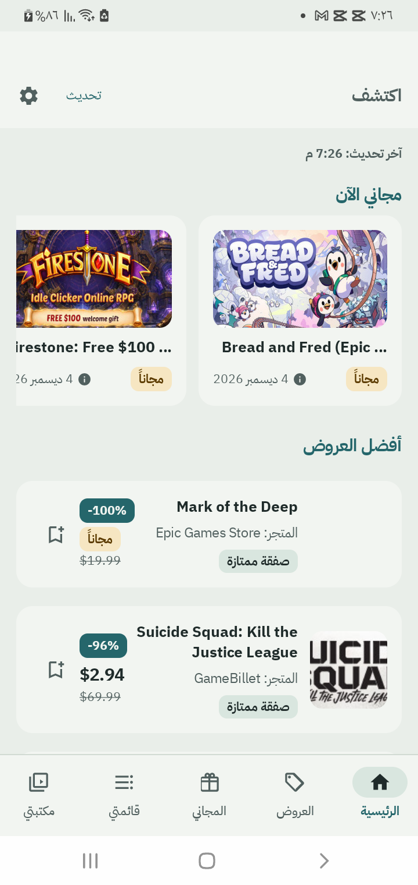
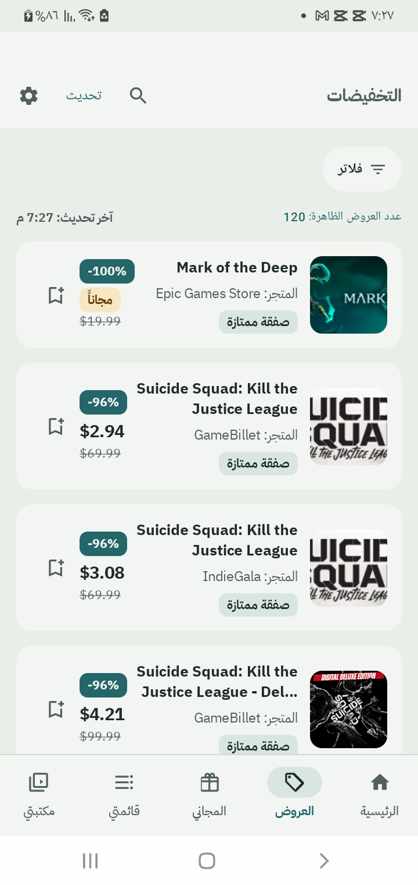
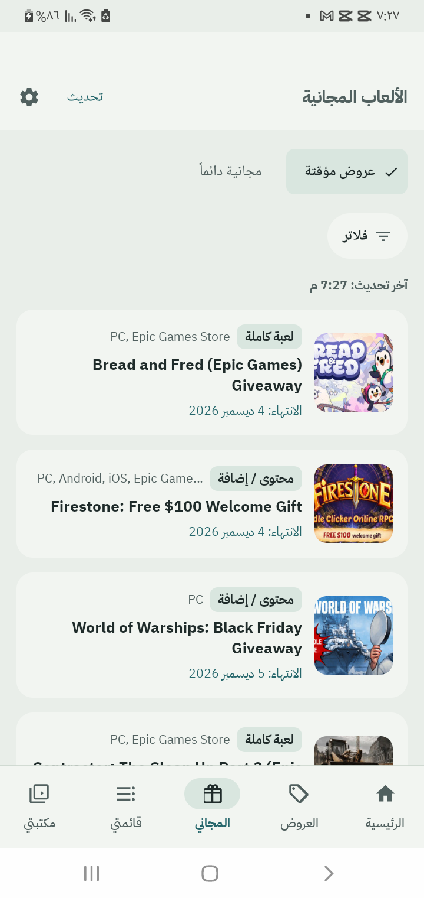

# Game Deals Hub 🎮

**تطبيق أندرويد مجاني لمتابعة تخفيضات ألعاب الحاسوب والألعاب المجانية أولاً بأول بواجهة عربية**

---

## نبذة عن التطبيق

يساعدك تطبيق **Game Deals Hub** على اكتشاف أفضل تخفيضات ألعاب الحاسوب (PC) والألعاب المجانية لفترة محدودة على متاجر مثل **Steam** و**Epic Games Store** وغيرها في مكان واحد:

- **الصفحة الرئيسية (اكتشف):** تجميع يومي للألعاب المجانية حالياً وأقوى التخفيضات والصفقات المميزة.
- **تبويب العروض:** تصفح وفلترة التخفيضات حسب المتجر والسعر ونسبة الخصم.
- **تبويب المجاني:** متابعة الألعاب والمحتويات المجانية مع تنبيه للعروض التي تنتهي قريباً.
- **واجهة عربية واضحة:** عرض الأسعار، نسب الخصم، تفاصيل العروض، والترجمة العربية لملخصات الألعاب.
- **قائمتي وإشعارات يومية:** حفظ العروض المفضلة وتلقي ملخص يومي بالتخفيضات والألعاب المجانية الجديدة.

---

## لقطات من التطبيق

  
  
  

---

## طريقة التثبيت والاستخدام

1. انتقل إلى صفحة [**الإصدارات (Releases)**](https://github.com/Reda6Dev/GameDealsHub/releases) ونزّل أحدث ملف `APK` (`GameDealsHub-v1.2.apk`).
2. افتح الملف على هاتفك الأندرويد (يتطلب **Android 8.0** أو أحدث)، واسمح بالتثبيت من هذا المصدر عند الطلب.
3. شغّل التطبيق لتصفح الألعاب المجانية وأفضل العروض فوراً، ويمكنك تفعيل الإشعار اليومي من تبويب **الإعدادات**.

---

تطوير: **Reda6Dev**

